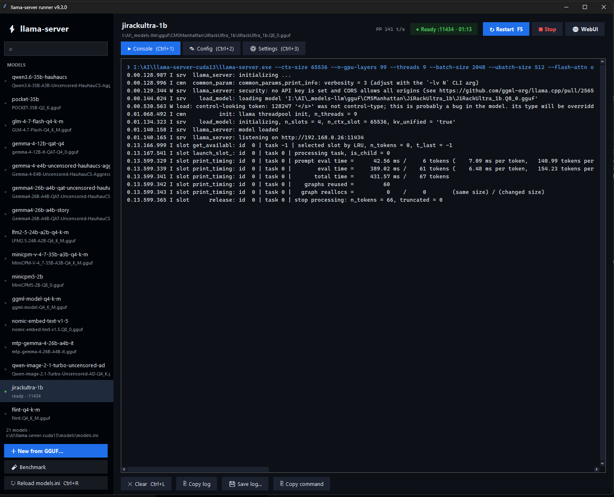
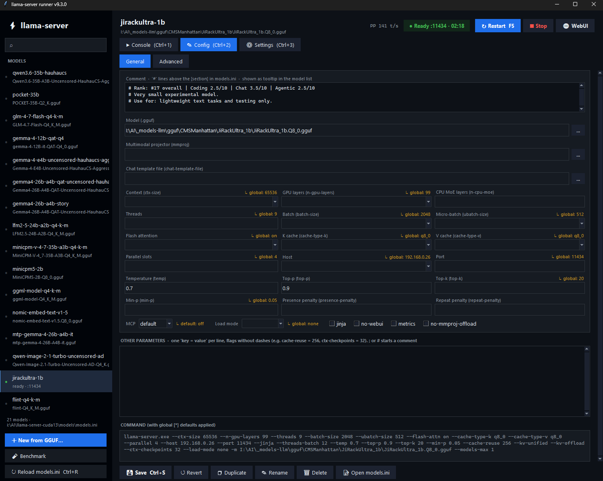
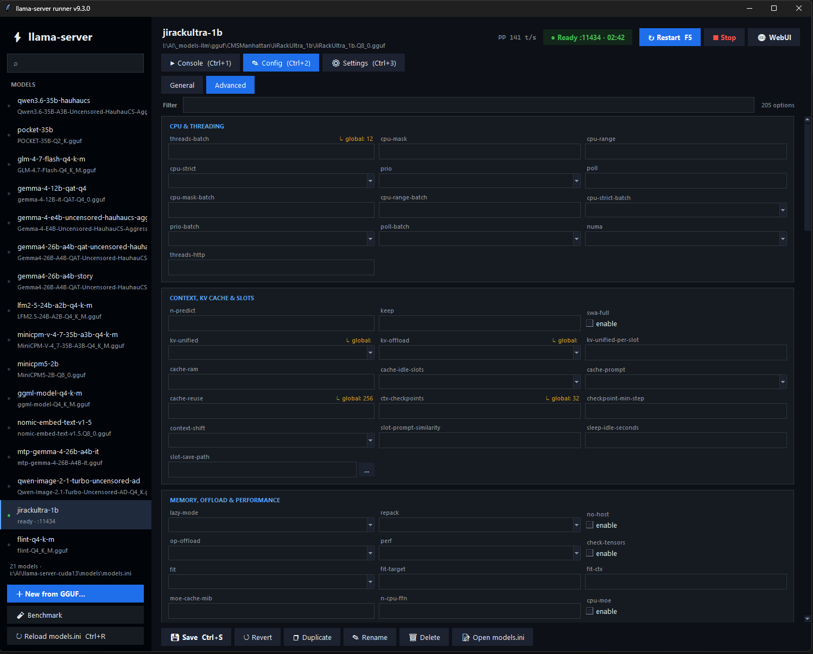
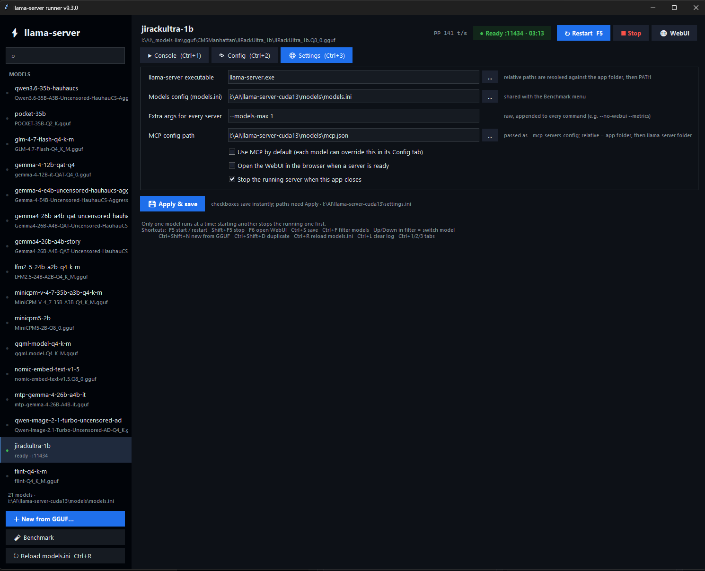
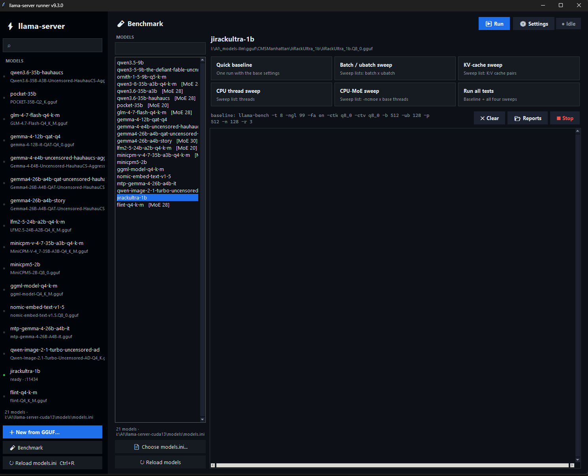
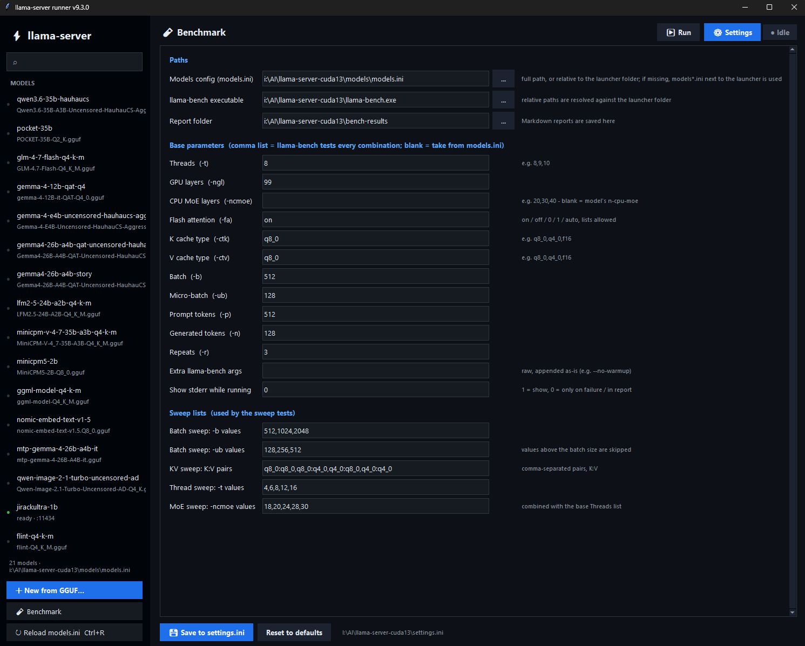

<div align="center">

# ⚡ llama-server runner

**A fast, keyboard-friendly desktop launcher for [`llama-server`](https://github.com/ggml-org/llama.cpp/tree/master/tools/server).**
Pick a model, tweak its flags, hit **F5**. Every model lives as a section in a single `models.ini`.





</div>

---

## Why

Juggling a pile of `.bat` files for every model and every flag combination gets old quickly. This app replaces them with:

- one **`models.ini`** holding all your model presets,
- a **config editor** so you never hand-edit flags again,
- a **live console** with start / stop / restart on a single key.

It is a single small Tkinter app with no third-party runtime dependencies.

## Features

|                              |                                                                                                                                                                                                                  |
| ---------------------------- | ---------------------------------------------------------------------------------------------------------------------------------------------------------------------------------------------------------------- |
| **Models from `models.ini`** | Each `[section]` is a model. `[*]` holds defaults every model inherits. Same format as llama-server's router-mode presets (keys are flags without the leading dashes).                                           |
| **Built-in config editor**   | Form fields for the common flags (context, GPU layers, `n-cpu-moe`, threads, batch/ubatch, flash-attn, K/V cache types, parallel, host, port, mmproj, jinja, mlock, …) plus a free-text box for everything else. |
| **Live command preview**     | See the exact command line, with global defaults merged in, before you start. Inherited values are hinted (`↳ global: 32768`).                                                                                   |
| **One-key control**          | `F5` start / restart, `Shift+F5` stop, `F6` open WebUI.                                                                                                                                                          |
| **One model at a time**      | Starting a model automatically stops the running one first, then launches the new one once the old process has exited. Handy on a single GPU.                                                                    |
| **Auto-open WebUI**          | Optional. Opens the browser when the server is ready (detected from the log line or a `/health` check, whichever comes first).                                                                                   |
| **MCP support**              | Global `--mcp-servers-config` path and "Use MCP" switch, with a per-model override (`default` / `on` / `off`).                                                                                                   |
| **Speed readout**            | Prompt-processing and generation tokens/s parsed from the server log and shown in the header.                                                                                                                    |
| **Benchmark menu**           | `llama-bench` runner with sweeps (batch, KV cache, threads, MoE) and Markdown reports, using the same `models.ini`.                                                                                              |
| **Safe editing**             | Comments and layout in `models.ini` are preserved; a `models.ini.bak` is written on every save; edits made in an external editor are picked up when the window regains focus.                                    |
| **Quality of life**          | Model filter with arrow-key switching, context menu, duplicate / rename / delete, "New from GGUF…" file picker, log copy/save, dark theme with dark title bar.                                                   |

## Quick start

### Option A: download the release

Grab the latest `LlamaRunner-*-win64.zip` from the [**Releases**](../../releases) page, unzip it, and run `LlamaRunner.exe`.

> ⚠️ **Read the antivirus note below first.**

### Option B: run from source

```bat
git clone https://github.com/merlinwarage/Llama-Runner.git
cd Llama-Runner
run-dev.bat
```

Needs **Windows** and **Python 3.10+** with Tkinter. There is nothing to `pip install` to run it.

### Option C: build your own `.exe`

See [Building from source](#building-from-source).

### First run

1. Open the **Settings** tab and set the path to your `llama-server.exe`. [https://github.com/ggml-org/llama.cpp](https://github.com/ggml-org/llama.cpp)
2. Point **Models config** at your `models.ini` (or use the bundled example).
3. Select a model in the sidebar and press **F5**.

> No models yet? Click **＋ New from GGUF…**, pick a `.gguf` file, and a section is created for you.

## ⚠️ Antivirus warning

The released `LlamaRunner.exe` is built with [PyInstaller](https://pyinstaller.org) in single-file mode and is **not code-signed**. Code-signing certificates cost money, and this is a free hobby project.

Because of that, **Windows Defender, SmartScreen or other antivirus tools may flag the exe as suspicious or even as a trojan. This is a known false positive.** Unsigned PyInstaller one-file executables are flagged often. PyInstaller's bootloader is the one piece all PyInstaller apps share, and some malware uses it too, so scanners get suspicious. The exe also unpacks itself to a temporary folder at startup, which looks like malware behaviour to some scanners.

**The app is plain Python and the full source is in this repository.** If you don't trust the binary or your antivirus blocks it:

1. **Build it yourself** (it takes about a minute, see below), or
2. **Run it straight from source** with `run-dev.bat`, no exe needed, or
3. Check the file on [VirusTotal](https://www.virustotal.com) and decide for yourself.

If you build it yourself and your antivirus still complains, these usually help:

- Build as a folder instead of a single file: remove `--onefile` from `build.bat` (the result is `dist\LlamaRunner\LlamaRunner.exe` plus support files). It is flagged much less often.
- Use the latest PyInstaller: `pip install --upgrade pyinstaller`.
- Build PyInstaller's bootloader yourself (needs a C compiler, such as Visual Studio Build Tools). See the [PyInstaller docs](https://pyinstaller.org/en/stable/bootloader-building.html).
- Add an exclusion for the app folder in your antivirus, or report the file as a false positive to the vendor.

## Building from source

### Requirements

| Requirement          | Details                                                                                                                                                                                                                                     |
| -------------------- | ------------------------------------------------------------------------------------------------------------------------------------------------------------------------------------------------------------------------------------------- |
| **OS**               | Windows 10 / 11, 64-bit (the app uses `taskkill` and Windows-specific APIs; builds on other OSes are not supported).                                                                                                                        |
| **Python**           | 3.10 or newer, 64-bit, from [python.org](https://www.python.org/downloads/windows/), installed with the **py launcher**, **pip**, and **tcl/tk and IDLE** options enabled (Tkinter ships with these; the Microsoft Store build also works). |
| **PyInstaller**      | Installed automatically by `build.bat` (`pip install --upgrade pyinstaller`). Listed in `requirements-build.txt`.                                                                                                                           |
| **Internet**         | Needed once to download PyInstaller with pip.                                                                                                                                                                                               |
| **Runtime packages** | **None.** The app only uses the Python standard library (`tkinter`, `configparser`, `subprocess`, `threading`, `urllib`, …).                                                                                                                |
| **Optional**         | A C compiler (Visual Studio Build Tools) only if you want to rebuild PyInstaller's bootloader.                                                                                                                                              |

Check your setup:

```bat
py --version
py -c "import tkinter; print('tk', tkinter.TkVersion)"
```

### Build

```bat
git clone https://github.com/<you>/<repo>.git
cd <repo>
build.bat
```

`build.bat` cleans old output, installs PyInstaller, and runs:

```bat
py -m PyInstaller --clean --onefile --noconsole ^
   --hidden-import bench_panel --hidden-import server_panel ^
   --name LlamaRunner launcher.py
```

The result is `dist\LlamaRunner.exe`. `models.ini`, `settings.ini` and `mcp.json` are copied next to it if they exist in the project folder.

Prefer a clean, isolated build? Use a virtual environment:

```bat
py -m venv .venv
.venv\Scripts\activate
pip install -r requirements-build.txt
build.bat
```

### Run without building

```bat
run-dev.bat
```

### Publishing a release (maintainers)

Push a version tag and let GitHub Actions build and attach the zip. See `.github/workflows/release.yml`.

```bat
git tag v1.0.0
git push origin v1.0.0
```

## `models.ini`

One section per model. Keys are `llama-server` flags **without the leading dashes**. `[*]` holds defaults; a model's own keys override them.

```ini
; Defaults inherited by every model
[*]
threads = 8
n-gpu-layers = 99
flash-attn = on
cache-type-k = q8_0
cache-type-v = q8_0
batch-size = 2048
ubatch-size = 512
ctx-size = 32768
jinja = true
temp = 0.6
top-k = 20

[Qwen3-0.6B-Q8_0]
model = I:/AI/models/Qwen3-0.6B-Q8_0.gguf
mmproj =                 ; empty values are ignored
mcp = on                 ; app-only key, see below

[Qwen3-30B-A3B]
model = I:/AI/models/Qwen3-30B-A3B-Q4_K_M.gguf
n-cpu-moe = 28
ctx-size = 65536
mcp = off
```

**How keys become arguments**

- `key = value` becomes `--key value`. One- and two-letter keys and common short names (`ngl`, `ctk`, `ctv`, …) get a single dash.
- `model` becomes `-m`. Relative paths are resolved against the folder containing `models.ini`.
- Boolean flags (`jinja`, `mlock`, `no-webui`, `metrics`, …): `true` adds the flag, `false` omits it. Negatable ones (like `mmap = false`) become `--no-mmap`.
- Value flags such as `flash-attn = on` are passed through as written.
- **Empty values are ignored**, so `mmproj =` will not produce a dangling `--mmproj`.
- `mcp`, `load-on-startup` and `stop-timeout` are app-level keys and are never passed to `llama-server`.

## MCP

Set once in **Settings**:

- **MCP config path**, passed as `--mcp-servers-config <path>`. A relative path is tried against the app folder first, then the `llama-server.exe` folder.
- **Use MCP by default**, the global switch.

Then override per model in its **Config** tab (`default` / `on` / `off`). The choice is stored as `mcp = on|off` in that model's section, or in `[*]` to apply to all models. If MCP is enabled but the file cannot be found, the server is not started and the console says which paths were checked.

## Keyboard shortcuts

| Key                  | Action                                        |
| -------------------- | --------------------------------------------- |
| `F5`                 | Start model (restart if running)              |
| `Shift+F5`           | Stop (also cancels a pending start)           |
| `F6`                 | Open WebUI in the browser                     |
| `Ctrl+S`             | Save config to `models.ini`                   |
| `Ctrl+F`             | Focus model filter (`↑` / `↓` switches model) |
| `Ctrl+Shift+N`       | New model from a GGUF file                    |
| `Ctrl+Shift+D`       | Duplicate selected model                      |
| `Ctrl+R`             | Reload `models.ini`                           |
| `Ctrl+L`             | Clear console                                 |
| `Ctrl+1` / `2` / `3` | Console / Config / Settings tab               |

Starting a model auto-saves unsaved config changes first.

## Settings reference

Stored in `settings.ini` next to the app (shared with the Benchmark menu):

```ini
[paths]
models_ini = models.ini
bench_exe  = llama-bench.exe

[server]
server_exe   = I:\AI\llama-server-cuda13\llama-server.exe
extra_args   =                      ; appended to every command
open_browser = 1                    ; open WebUI when ready
stop_on_exit = 1                    ; stop the server when the app closes
mcp_config   = ..\models\mcp.json
use_mcp      = 0
```

The checkboxes in the Settings tab save instantly. Paths need **Apply & save**.

## Project layout

```
launcher.py             App window, sidebar, shortcuts, theme
server_panel.py         llama-server runner: models.ini editor, process control, console
bench_panel.py          llama-bench menu (sweeps + Markdown reports)
build.bat               PyInstaller one-file build
run-dev.bat             Run from source
requirements-build.txt  Build-time dependency (PyInstaller)
models.ini              Example presets
settings.ini            Example settings
```

## Notes and limitations

- **Windows only.** Process control relies on `taskkill`, and there are a few Windows-specific touches (dark title bar, Explorer integration).
- **Stop is a hard kill** (`taskkill /T /F`), not a graceful shutdown.
- **Single model by design.** Starting a second model always stops the first.
- Per-model environment variables (for example `CUDA_VISIBLE_DEVICES`) are not supported yet.
- Flag names are passed through as written, so use the names your `llama-server` build understands (`llama-server --help`).

## Troubleshooting

| Problem                                                 | Fix                                                                                                                                     |
| ------------------------------------------------------- | --------------------------------------------------------------------------------------------------------------------------------------- |
| Antivirus blocks or deletes `LlamaRunner.exe`           | Known false positive for unsigned PyInstaller apps, see [Antivirus warning](#️-antivirus-warning). Build it yourself or run from source. |
| `llama-server not found`                                | Set the path in **Settings** and press **Apply & save**.                                                                                |
| `error while handling argument "--xyz": expected value` | A key has a bare flag where a value is needed. Check the **Command** preview in the Config tab.                                         |
| WebUI does not open                                     | Enable **Open the WebUI…** in Settings. The console logs `[ready - opening …]` when it fires. Use **F6** to open it manually.           |
| `Port in use` prompt                                    | Another process is listening on that port. Change `port` for the model or stop the other process.                                       |
| `MCP config not found`                                  | Fix the path in Settings, or set the model's MCP to `off`.                                                                              |
| `No module named tkinter` when building                 | Reinstall Python from python.org with the **tcl/tk and IDLE** option enabled.                                                           |
| Edits in `models.ini` not showing                       | Press `Ctrl+R`. Unsaved changes in the editor block auto-reload.                                                                        |

## Contributing

Fork it, enjoy it. The app is two plain Python files plus the benchmark panel, with no build step beyond PyInstaller, so it is easy to hack on.

## License

MIT

## Acknowledgements

Built around [llama.cpp](https://github.com/ggml-org/llama.cpp) and its `llama-server` / `llama-bench` tools.
